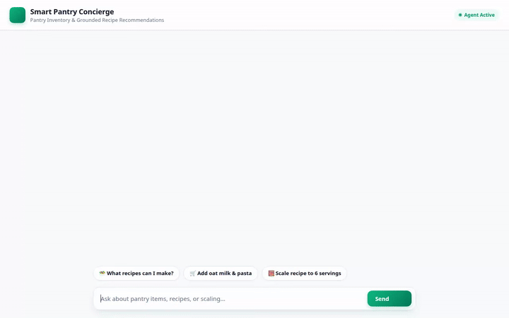

# Smart Pantry Agent 🥗

An intelligent, conversational pantry and recipe concierge built with Google's Agent Development Kit (ADK). The agent manages your pantry inventory, recommends recipes matched to your available ingredients, generates visual food photography and short videos, and remembers dietary restrictions and allergies across conversations.



---

## 🌟 Implemented Features & Architecture

This repository implements the following core tools and Google Cloud service integrations:

### 🧠 Vertex AI Memory Bank
- **Persistent Allergy & Preference Memory**: Automatically extracts and retains user allergies (e.g., peanuts, gluten, dairy), dietary preferences, and cooking goals across session turns using `VertexAiMemoryBankService` and `PreloadMemoryTool`.

### 🗄️ Google Cloud Firestore
- **Pantry Inventory Management**: Directly reads and writes to the `pantry_items` collection in Firestore.
  - `get_pantry_items`: Queries stock by category or lists full inventory.
  - `add_pantry_item`: Adds new items or updates stock levels and expiration dates.
  - `use_pantry_item`: Decrements ingredient quantities when cooking.
  - `generate_grocery_shopping_list`: Scans inventory for low stock or items expiring within 30 days.

### 🎨 Vertex AI Multimodal Generation & Cloud Storage
- **Image Generation (`gemini-3.1-flash-lite-image`)**: Generates high-quality food photography (`generate_pantry_item_image`) and uploads bytes to a public Google Cloud Storage bucket.
- **Video Generation (`gemini-omni-flash-preview`)**: Generates short culinary videos (`generate_pantry_item_video`) via the Interactions API, saving artifacts and publishing to Cloud Storage.

### 🎛️ A2UI (Adaptive Agent UI v0.8)
- **Rich Card Rendering**: Formats structured responses into clean A2UI surfaces (Card, Column, Row, Text, Image) via `A2uiSchemaManager` and `after_model_callback`.

### 📍 Maps & Recipe Search
- **Google Maps Geocoding & Places API (New)**: `geocode_address` and `find_nearby_places` to locate nearby grocery stores and markets.
- **TheMealDB API**: `search_online_recipes` to fetch real online recipes with ingredient lists and preparation steps.

---

## 🚀 Local Setup & Running Instructions

### Prerequisites
- Python 3.11+
- Google Cloud Project with Vertex AI, Firestore, and Cloud Storage enabled
- Authenticated `gcloud` CLI (`gcloud auth application-default login`)

### 1. Install Dependencies
```bash
pip install -r requirements.txt
```

### 2. Configure Environment Variables
Copy or create a `.env` file in the project root:
```env
GOOGLE_MAPS_API_KEY="YOUR_KEY_HERE"
THEMEALDB_API_KEY="1"
```

### 3. Run the Agent Playground
Start the ADK dev UI locally:
```bash
agents-cli playground
```

### 4. Run the Custom Web Frontend
Navigate to the `frontend/` directory and start the FastAPI proxy server:
```bash
cd frontend
pip install -r requirements.txt
python main.py
```
Open a browser and navigate to the local server port printed in terminal (default port 8080).

---

## 🛠️ Project Structure

```
.
├── app/
│   ├── agent.py         # ADK Agent definition, Memory Bank, and A2UI callbacks
│   ├── tools.py         # Firestore, GCS, Image/Video generation, and Maps tools
│   └── a2ui_utils.py    # A2UI response formatting callback
├── frontend/
│   ├── main.py          # FastAPI proxy server connecting UI to Agent Platform
│   ├── static/          # Rebranded HTML, CSS, and JS frontend
│   └── Dockerfile       # Container definition for Cloud Run deployment
├── agents-cli-manifest.yaml # ADK agent deployment manifest
├── pyproject.toml       # Python package dependencies
└── README.md
```
